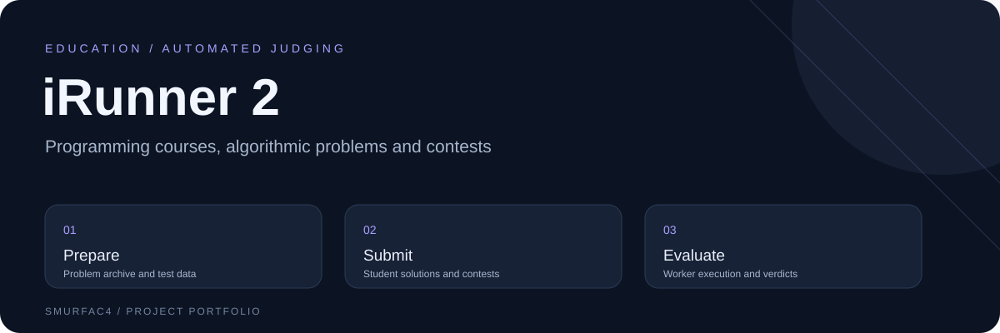

<p align="center"></p>

# iRunner 2 · Programming courses & automated judging

A customized version of **Insight Runner 2**, a Django platform for teaching programming and running algorithmic contests. Teachers manage problems, test data and courses; students submit solutions and receive automated judging results.

This repository builds on the original iRunner2 project by Sergei Sobol and its contributors, developed for use at Belarusian State University. The original authorship and Git history are preserved. The work by **smurfac4** extends that platform rather than replacing its provenance.

## Platform capabilities

- A problem archive with statements, test cases and judging settings.
- Courses, contests, submissions, standings and feedback.
- Worker-based execution of submitted programs and storage of results.
- User and group administration, authentication and two-factor authentication.
- Plagiarism review tools and submission source inspection.

## Custom work in this repository

| Change | Implementation | Branch |
| --- | --- | --- |
| Dark theme | Theme controls in the base layout and user profile | Both branches |
| Docker worker | A separate simple worker and API endpoints for taking jobs and reporting results | `master` |
| Bash and Python checks | Additional execution and checker handling in the simple worker, including Python test-function harnesses | `master` |
| Judging presentation | Changes to the displayed test numbering | `master` |
| Plagiarism review | A plagiarism flag on submissions, review actions and source/results presentation | `master` |
| Google Sheets export | Apps Script and browser-console helpers for importing course standings | `master` |
| Model migrations | Additional migrations for model changes in the main branch | `master` |
| Single active session | Session-key tracking, login/logout hooks, middleware and user-facing messages | `single-session` |

These entries describe changes visible in the source and commit history; they are not a claim that every deployment or platform combination has been validated.

## Branch guide

| Branch | Purpose |
| --- | --- |
| [`master`](https://github.com/smurfac4/irunner2/tree/master) | Main development branch with the worker, judging, plagiarism and Google Sheets changes |
| [`single-session`](https://github.com/smurfac4/irunner2/tree/single-session) | Separate session-management branch based on an earlier revision; it does not contain all later `master` changes |

**You are viewing `single-session`.** This branch records one active Django session key per user. A login updates the stored key; middleware logs out a request using a different session key and displays a message. The implementation uses session keys, not IP-address matching. It also includes session-model migrations and message rendering in the base layout.

Review and test this behavior before deployment. This branch is based on an earlier version of the project and should not be treated as a copy of the current `master` branch.

## Repository map

| Path | Contents |
| --- | --- |
| `project/irunner2/middleware.py` | Active-session enforcement |
| `project/users/models.py` | Session model and authentication hooks |
| `project/users/migrations/` | User-model migrations |
| `project/api/migrations/` | API migrations, including a session-model migration |
| `project/templates/base.html` | Base layout, theme and session messages |
| `irunner-unix-worker/` | Original judging worker |
| `requirements.txt` | Web application dependencies |

## Local development

The web application uses a legacy dependency stack, including **Django 3.1.2**. Use an isolated development environment and review dependency compatibility before installation. Production readiness and a fresh installation have not been validated as part of this README update.

```bash
git clone https://github.com/smurfac4/irunner2.git
cd irunner2
git checkout single-session
python3 -m venv .venv
source .venv/bin/activate
python -m pip install -r requirements.txt
export DJANGO_SETTINGS_MODULE=irunner2.settings_dev
cd project
python manage.py migrate
python manage.py createsuperuser
python manage.py runserver
```

On Windows, activate the environment with `.venv\Scripts\activate` and use `set DJANGO_SETTINGS_MODULE=irunner2.settings_dev` in Command Prompt. The dependency list includes `mysqlclient`, which may need native build tools and MySQL client headers even when the development configuration uses SQLite.

The development server listens on `http://127.0.0.1:8000/`. Running the web application does not start a judge worker.

## Worker and deployment notes

- [Worker setup](irunner-unix-worker/README.md) explains the original worker and configuration.
- [Worker image](irunner-unix-worker/vm/README.md) covers the original Docker image.
- [Django configuration](project/irunner2/README.md) explains private production settings.
- [IIS configuration](inetpub/README.md) covers the supplied Windows hosting files.

Keep production secrets outside Git. Submitted programs require an appropriately isolated judging environment. Review the legacy dependencies, worker configuration and deployment settings before exposing an installation publicly.
